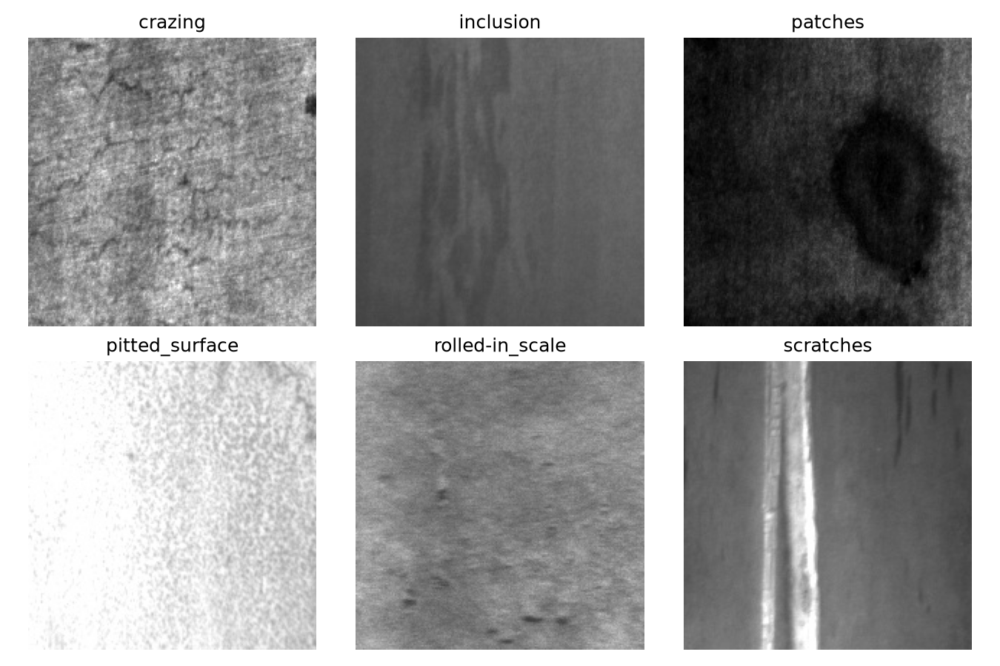
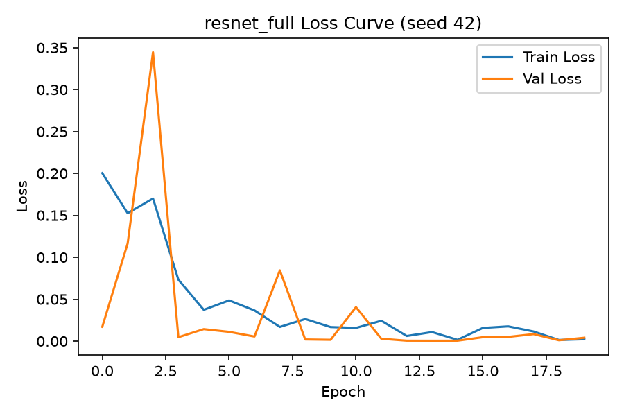
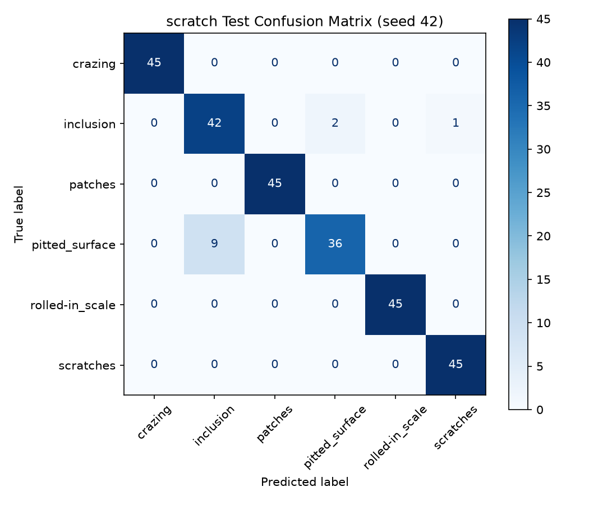
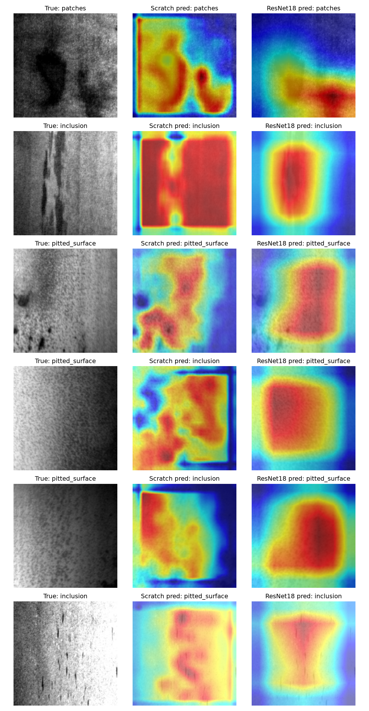

# Explainable Industrial Surface Defect Classification

An end-to-end PyTorch computer vision benchmark investigating two core questions in automated steel surface inspection:
1. **Does transfer learning (pretrained ResNet18) outperform a CNN trained from scratch** on industrial surface defects—both on clean images and under real-world lighting/sensor degradation?
2. **Do both models actually look at the defect** when making their decisions?

---

## Key Findings

* **Clean Performance (3-Seed Mean ± Std):** Full fine-tuning of ResNet18 achieved **100.00% ± 0.00%** test macro-F1 across 3 random seeds, outperforming a frozen-backbone ResNet18 (**97.85% ± 1.72%**) and a 4-block CNN trained from scratch (**96.18% ± 0.49%**).
* **Robustness Under Degradation:** Because clean NEU images are tightly cropped and high-contrast, the true gap appears under stress testing. Under **+0.4 brightness shifts**, the scratch CNN dropped **21.1 percentage points** (`95.56%` → `74.44%`), whereas ResNet18 dropped only **0.4 points** (`100.00%` → `99.63%`). Under combined **Gaussian noise ($\sigma=0.2$) + brightness (+0.4)**, the scratch CNN collapsed to **20.00%** (near random guessing at 16.7%), while ResNet18 retained **72.59%** accuracy.
* **Error & Explainability Analysis (Grad-CAM):** On clean test images, **11 of the scratch CNN's 12 errors** were confusion between `pitted_surface` and `inclusion`. Side-by-side Grad-CAM heatmaps show that ResNet18 tightly localizes the defect geometry (e.g., vertical inclusion streaks and central pitted regions), whereas the scratch CNN frequently exhibits diffuse attention that drifts toward background margins on failure cases.

---

## Dataset

* **Source:** [NEU Surface Defect Database (NEU-DET) on Kaggle](https://www.kaggle.com/datasets/kaustubhdikshit/neu-surface-defect-database) *(original research dataset by Northeastern University)*.
* **Contents:** 1,800 grayscale images ($200 \times 200$ px) across 6 balanced steel surface defect classes (300 images per class):
  * `crazing`
  * `inclusion`
  * `patches`
  * `pitted_surface`
  * `rolled-in_scale`
  * `scratches`
* **Data Licensing Note:** Raw images are excluded from this repository via `.gitignore`. Download the dataset directly from the Kaggle link above and place it in `data/raw/NEU-DET/`.



---

## Methodology

### 1. Data Splitting & Leakage Prevention
All 1,800 images were pooled and partitioned using a **stratified 70/15/15 split** with a fixed seed (`random_state=42`):
* **Train:** 1,260 images (210 per class)
* **Validation:** 270 images (45 per class) — used for model checkpointing (`best_val_f1`)
* **Test:** 270 images (45 per class) — **held out and evaluated once** at the end of each run

### 2. Model Architectures
* **Scratch CNN (`ScratchCNN`):** 4 convolutional blocks (`1→32→64→128→256` channels, $3\times3$ kernels) with `BatchNorm2d`, `ReLU`, `MaxPool2d`, `AdaptiveAvgPool2d((1, 1))`, and `Dropout(0.3)`. Trained on 1-channel grayscale images normalized to `mean=0.5, std=0.5`.
* **ResNet18 (Frozen Backbone):** ImageNet-pretrained `ResNet18` (`IMAGENET1K_V1`) with all convolutional layers frozen and only the final linear classification head trained. Grayscale images are converted to 3-channel RGB, resized to $224\times224$, and normalized with ImageNet statistics.
* **ResNet18 (Full Fine-Tuning):** Same pretrained `ResNet18` with all layers unfrozen and fine-tuned end-to-end at a lower learning rate (`3e-4` vs. `1e-3`).

### 3. Training & Evaluation Protocol
* **Augmentation (Train only):** Random horizontal flip, random vertical flip, and random rotation ($\pm 10^\circ$).
* **Optimizer & Loss:** `AdamW` (`weight_decay=1e-4`), `CrossEntropyLoss`, 20 epochs, batch size 32.
* **Multi-Seed Evaluation:** Every configuration was trained and evaluated across **3 independent seeds (`42, 123, 999`)** to quantify variance (with 270 test images, 1 image $\approx 0.37\%$).

---

## Results

### 1. Clean Test Set Performance (3-Seed Mean ± Std)

| Model | Test Accuracy (Mean ± Std) | Test Macro-F1 (Mean ± Std) |
| :--- | :---: | :---: |
| **Scratch CNN** | `96.17% ± 0.46%` | `96.18% ± 0.49%` |
| **ResNet18 (Frozen)** | `97.90% ± 1.67%` | `97.85% ± 1.72%` |
| **ResNet18 (Full Fine-Tune)** | **`100.00% ± 0.00%`** | **`100.00% ± 0.00%`** |

### 2. Training Dynamics & Error Analysis

Full fine-tuning of ResNet18 converges rapidly—recovering from an early epoch-2 validation spike to stabilize near zero loss by epoch 12:



On seed 42, the scratch CNN achieved 100% precision and recall on `crazing`, `patches`, `rolled-in_scale`, and `scratches` (45/45 each), but struggled to separate `pitted_surface` from `inclusion` (9 `pitted_surface` samples misclassified as `inclusion`, and 2 `inclusion` samples misclassified as `pitted_surface`):



### 3. Robustness Stress Test (Seed 42)

To simulate factory camera noise and lighting drift, additive Gaussian noise and brightness offsets were applied to the held-out test set at inference time:

| Test Condition | Scratch CNN Accuracy | ResNet18 (Full) Accuracy | Gap (ResNet18 − Scratch) |
| :--- | :---: | :---: | :---: |
| **Clean** | `95.56%` | `100.00%` | `+4.44%` |
| **Brightness (+0.4)** | `74.44%` (`-21.12`) | `99.63%` (`-0.37`) | **`+25.19%`** |
| **Gaussian Noise ($\sigma=0.2$)** | `32.22%` (`-63.34`) | `70.00%` (`-30.00`) | **`+37.78%`** |
| **Noise + Brightness** | `20.00%` (`-75.56`) | `72.59%` (`-27.41`) | **`+52.59%`** |

**Takeaway:** Pretrained ImageNet filters provide strong invariance to illumination shifts and moderate sensor noise, whereas a CNN trained from scratch on 1,260 grayscale images over-relies on raw pixel intensity distributions and breaks down rapidly under distribution shift.

---

## Explainability (Grad-CAM)

Grad-CAM was computed on the final convolutional block of both models (`ScratchCNN.features[-1]` and `ResNet18.layer4[-1]`) across correct predictions (top 3 rows) and scratch CNN failure cases (bottom 3 rows):



**Visual Findings:**
* **Localized vs. Diffuse Attention:** On `inclusion` samples (rows 2 & 6), ResNet18 places a tight, high-intensity activation directly along the vertical defect streak. The scratch CNN spreads activation broadly across background margins.
* **Failure Mode Explanation:** On `pitted_surface` images misclassified by the scratch CNN as `inclusion` (rows 4 & 5), the scratch model focuses on fragmented edge/corner artifacts rather than the central pitted texture—whereas ResNet18 attends cleanly to the pitted surface itself.

---

## Repository Structure

```text
neu-defect-xai/
├── .gitignore
├── README.md
├── requirements.txt
├── outputs/
│   ├── test_summary.csv
│   └── figures/
│       ├── samples.png
│       ├── loss_scratch.png
│       ├── loss_resnet_frozen.png
│       ├── loss_resnet_full.png
│       ├── cm_scratch.png
│       ├── cm_resnet_frozen.png
│       ├── cm_resnet_full.png
│       └── gradcam_comparison.png
└── src/
    ├── make_split.py             # Stratified 70/15/15 split & class balance check
    ├── models.py                 # NEUDataset, ScratchCNN, and ResNet18 builders
    ├── train_and_eval.py         # 3-seed training loop, loss curves, and test evaluation
    └── robustness_and_gradcam.py # Noise/brightness stress test & side-by-side Grad-CAM
```

---

## How to Reproduce

1. **Clone the repository and set up the virtual environment:**
   ```powershell
   git clone [https://github.com/YOUR_USERNAME/neu-defect-xai.git](https://github.com/YOUR_USERNAME/neu-defect-xai.git)
   cd neu-defect-xai
   python -m venv .venv
   .\.venv\Scripts\Activate.ps1   # Linux/macOS: source .venv/bin/activate
   pip install -r requirements.txt
   ```
2. **Download the dataset:**
   Download [NEU-DET from Kaggle](https://www.kaggle.com/datasets/kaustubhdikshit/neu-surface-defect-database) and extract it to `data/raw/NEU-DET/`.
3. **Run the full pipeline:**
   ```powershell
   python src/make_split.py
   python src/train_and_eval.py
   python src/robustness_and_gradcam.py
   ```

---

## Limitations & Future Work

* **Lab-Condition Benchmark:** Achieving 100% clean accuracy reflects the controlled, tightly cropped nature of NEU-DET rather than real-world factory difficulty. Evaluating on coil-level (grouped) splits would better measure generalization to unseen steel batches.
* **Quantitative Localization:** NEU-DET provides XML bounding boxes for each defect. A natural next step is computing **Grad-CAM Pointing Game / IoU overlap** against ground-truth bounding boxes to quantitatively score explainability.